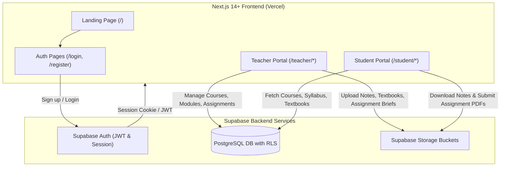
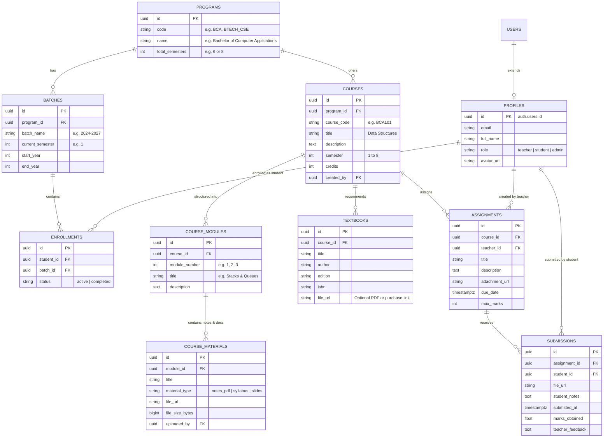

```# Course Management System - Architecture & Implementation Plan

## 1. Project Overview

A modern, role-based Course Management System (CMS) designed for higher education institutions offering multiple undergraduate and postgraduate technical programs (e.g., **BCA**, **B.Tech CSE**, **B.Tech IT**, etc.). 

The system organizes academic curricula **semester-wise** and provides dedicated operational portals for two primary user groups:
- **Teachers**: Can create/manage semester-wise courses, structure course indices and syllabus modules, upload study notes (PDFs), textbook recommendations, and create assignments.
- **Students**: Self-enroll into their respective program and batch upon registration, browse their current semester courses, download learning materials, and submit assignments.

---

## 2. Confirmed Business Rules & Requirements

| Aspect | Decision | Implementation Details |
|---|---|---|
| **Student Enrollment** | Self-selected during registration | During signup, students choose their Program (e.g. BCA, B.Tech) and Batch/Semester. An active enrollment record is automatically created. |
| **Teacher Registration** | Open registration | Anyone can sign up as a teacher; immediate access to the teacher portal. |
| **Course Management** | Open access for all teachers | Any verified teacher can create courses, upload syllabus modules, notes, textbooks, and create assignments. |
| **Hosting & Database** | Next.js (Vercel) + Supabase | Database (PostgreSQL + RLS), Authentication (Supabase Auth), Storage (Supabase Storage Buckets), and Next.js 14+ App Router. |

---

## 3. High-Level System Architecture



---

## 4. Entity Relationship (ER) Diagram



---

## 5. Supabase SQL Schema (DDL & Policies)

```sql
-- ==============================================================================
-- 1. ENUMS & EXTENSIONS
-- ==============================================================================
create extension if not exists "uuid-ossp";

create type user_role as enum ('admin', 'teacher', 'student');
create type material_type as enum ('notes_pdf', 'syllabus', 'lecture_slide', 'reference_doc');
create type enrollment_status as enum ('active', 'completed', 'dropped');

-- ==============================================================================
-- 2. CORE TABLES
-- ==============================================================================

-- Profiles (extends Supabase auth.users)
create table public.profiles (
  id uuid references auth.users on delete cascade primary key,
  email text not null unique,
  full_name text not null,
  role user_role not null default 'student',
  avatar_url text,
  created_at timestamptz default now(),
  updated_at timestamptz default now()
);

-- Programs (BCA, B.Tech CSE, B.Tech IT, etc.)
create table public.programs (
  id uuid primary key default gen_random_uuid(),
  code text unique not null,
  name text not null,
  total_semesters int not null default 6,
  created_at timestamptz default now()
);

-- Batches per Program
create table public.batches (
  id uuid primary key default gen_random_uuid(),
  program_id uuid references public.programs(id) on delete cascade not null,
  batch_name text not null, -- e.g. '2024-2027'
  start_year int not null,
  end_year int not null,
  current_semester int not null default 1,
  created_at timestamptz default now()
);

-- Student Enrollments
create table public.enrollments (
  id uuid primary key default gen_random_uuid(),
  student_id uuid references public.profiles(id) on delete cascade not null,
  batch_id uuid references public.batches(id) on delete cascade not null,
  status enrollment_status not null default 'active',
  created_at timestamptz default now(),
  unique(student_id, batch_id)
);

-- Courses (Semester-wise curriculum)
create table public.courses (
  id uuid primary key default gen_random_uuid(),
  program_id uuid references public.programs(id) on delete cascade not null,
  course_code text not null,
  title text not null,
  description text,
  semester int not null,
  credits int default 4,
  created_by uuid references public.profiles(id) on delete set null,
  created_at timestamptz default now(),
  unique(program_id, course_code)
);

-- Course Modules (Syllabus Units)
create table public.course_modules (
  id uuid primary key default gen_random_uuid(),
  course_id uuid references public.courses(id) on delete cascade not null,
  module_number int not null,
  title text not null,
  description text,
  created_at timestamptz default now(),
  unique(course_id, module_number)
);

-- Course Notes, PDFs, and Files
create table public.course_materials (
  id uuid primary key default gen_random_uuid(),
  module_id uuid references public.course_modules(id) on delete cascade not null,
  title text not null,
  material_type material_type not null default 'notes_pdf',
  file_url text not null,
  file_size_bytes bigint,
  uploaded_by uuid references public.profiles(id) on delete set null,
  created_at timestamptz default now()
);

-- Recommended Textbooks
create table public.textbooks (
  id uuid primary key default gen_random_uuid(),
  course_id uuid references public.courses(id) on delete cascade not null,
  title text not null,
  author text not null,
  edition text,
  isbn text,
  file_url text,
  created_at timestamptz default now()
);

-- Assignments
create table public.assignments (
  id uuid primary key default gen_random_uuid(),
  course_id uuid references public.courses(id) on delete cascade not null,
  teacher_id uuid references public.profiles(id) on delete cascade not null,
  title text not null,
  description text,
  attachment_url text,
  due_date timestamptz not null,
  max_marks int default 100,
  created_at timestamptz default now()
);

-- Assignment Submissions
create table public.submissions (
  id uuid primary key default gen_random_uuid(),
  assignment_id uuid references public.assignments(id) on delete cascade not null,
  student_id uuid references public.profiles(id) on delete cascade not null,
  file_url text not null,
  student_notes text,
  submitted_at timestamptz default now(),
  marks_obtained float,
  teacher_feedback text,
  graded_at timestamptz,
  unique(assignment_id, student_id)
);

-- ==============================================================================
-- 3. ROW LEVEL SECURITY (RLS) POLICIES
-- ==============================================================================

alter table public.profiles enable row level security;
alter table public.programs enable row level security;
alter table public.batches enable row level security;
alter table public.enrollments enable row level security;
alter table public.courses enable row level security;
alter table public.course_modules enable row level security;
alter table public.course_materials enable row level security;
alter table public.textbooks enable row level security;
alter table public.assignments enable row level security;
alter table public.submissions enable row level security;

-- Profiles: Anyone authenticated can read profiles; users can update their own
create policy "Authenticated users can read profiles" on public.profiles
  for select to authenticated using (true);

create policy "Users can update their own profile" on public.profiles
  for update to authenticated using (auth.uid() = id);

-- Programs & Batches: Read-only for all authenticated users
create policy "Authenticated users can view programs" on public.programs
  for select to authenticated using (true);

create policy "Authenticated users can view batches" on public.batches
  for select to authenticated using (true);

-- Enrollments: Students can view their enrollments; insert during registration
create policy "Users can view their enrollments" on public.enrollments
  for select to authenticated using (auth.uid() = student_id);

create policy "Students can enroll themselves" on public.enrollments
  for insert to authenticated with check (auth.uid() = student_id);

-- Courses, Modules, Textbooks, Materials:
-- Read access: All authenticated users
-- Write access: Teachers
create policy "Authenticated read courses" on public.courses
  for select to authenticated using (true);

create policy "Teachers can insert/update courses" on public.courses
  for all to authenticated using (
    exists (select 1 from public.profiles where id = auth.uid() and role in ('teacher', 'admin'))
  );

create policy "Authenticated read modules" on public.course_modules
  for select to authenticated using (true);

create policy "Teachers can manage modules" on public.course_modules
  for all to authenticated using (
    exists (select 1 from public.profiles where id = auth.uid() and role in ('teacher', 'admin'))
  );

create policy "Authenticated read materials" on public.course_materials
  for select to authenticated using (true);

create policy "Teachers can manage materials" on public.course_materials
  for all to authenticated using (
    exists (select 1 from public.profiles where id = auth.uid() and role in ('teacher', 'admin'))
  );

create policy "Authenticated read textbooks" on public.textbooks
  for select to authenticated using (true);

create policy "Teachers can manage textbooks" on public.textbooks
  for all to authenticated using (
    exists (select 1 from public.profiles where id = auth.uid() and role in ('teacher', 'admin'))
  );

-- Assignments:
-- Read access: All authenticated users
-- Write access: Teachers
create policy "Authenticated read assignments" on public.assignments
  for select to authenticated using (true);

create policy "Teachers can manage assignments" on public.assignments
  for all to authenticated using (
    exists (select 1 from public.profiles where id = auth.uid() and role in ('teacher', 'admin'))
  );

-- Submissions:
-- Students can read & insert their own submission
-- Teachers can view all submissions and update grades
create policy "Students can view own submissions" on public.submissions
  for select to authenticated using (
    auth.uid() = student_id or 
    exists (select 1 from public.profiles where id = auth.uid() and role in ('teacher', 'admin'))
  );

create policy "Students can insert own submission" on public.submissions
  for insert to authenticated with check (auth.uid() = student_id);

create policy "Teachers can grade submissions" on public.submissions
  for update to authenticated using (
    exists (select 1 from public.profiles where id = auth.uid() and role in ('teacher', 'admin'))
  );
```

---

## 6. Supabase Storage Buckets

| Bucket Name | Access Level | Permitted Uploaders | Permitted Readers | Contents |
|---|---|---|---|---|
| `course-materials` | Public / Authenticated | Teachers, Admins | All authenticated students & teachers | Syllabus PDFs, lecture notes, slide decks |
| `textbooks` | Public / Authenticated | Teachers, Admins | All authenticated students & teachers | Digital textbook PDFs or reference manuals |
| `assignment-files` | Public / Authenticated | Teachers, Admins | All authenticated students & teachers | Assignment problem statement PDFs, datasets |
| `submissions` | Authenticated Private | Enrolled Students | The submitting student and teachers | Student homework/assignment solutions |

---

## 7. Next.js App Directory Structure

```
course_management/
├── app/
│   ├── (auth)/
│   │   ├── login/
│   │   │   └── page.tsx                 # Login with email/password
│   │   └── register/
│   │       └── page.tsx                 # Register: role selection (Student selects Program/Batch)
│   ├── (dashboard)/
│   │   ├── layout.tsx                   # Common dashboard layout (Nav, user menu, sidebar)
│   │   ├── teacher/
│   │   │   ├── courses/
│   │   │   │   ├── page.tsx             # All courses list, filter by Program & Semester
│   │   │   │   ├── new/page.tsx         # Create new course
│   │   │   │   └── [courseId]/
│   │   │   │       ├── page.tsx         # Course overview, modules, notes, textbooks
│   │   │   │       ├── modules/new/     # Add new module/index
│   │   │   │       └── materials/upload/# Upload PDF notes
│   │   │   ├── assignments/
│   │   │   │   ├── page.tsx             # Teacher assignments dashboard
│   │   │   │   ├── new/page.tsx         # Create assignment
│   │   │   │   └── [assignmentId]/      # View submissions & grade student work
│   │   │   └── page.tsx                 # Teacher home dashboard
│   │   └── student/
│   │       ├── courses/
│   │       │   ├── page.tsx             # Enrolled batch & semester courses
│   │       │   └── [courseId]/
│   │       │       └── page.tsx         # Course index, download notes, textbook links
│   │       ├── assignments/
│   │       │   ├── page.tsx             # Active & completed assignments
│   │       │   └── [assignmentId]/      # Assignment details & submission upload form
│   │       └── page.tsx                 # Student overview (current semester, deadlines)
│   ├── layout.tsx                       # Root layout & font definitions
│   └── page.tsx                         # Landing page with portal entrance
├── components/
│   ├── ui/                              # Buttons, Cards, Dialogs, Badges, Tabs
│   ├── navbar.tsx                       # Contextual navbar (Teacher vs Student links)
│   ├── file-upload.tsx                  # Drag-and-drop Supabase PDF uploader
│   ├── course-card.tsx                  # Reusable course presentation card
│   └── assignment-card.tsx              # Due date, status badge, submission CTA
├── lib/
│   ├── supabase/
│   │   ├── client.ts                    # Browser-side client (createBrowserClient)
│   │   ├── server.ts                    # Server component client (createServerClient)
│   │   └── middleware.ts                # Session refresher & role router
│   ├── types.ts                         # Database and UI TypeScript definitions
│   └── utils.ts                         # Tailwind cn helper, date formatting
├── middleware.ts                        # Edge middleware: protects routes by user role
├── .env.example                         # NEXT_PUBLIC_SUPABASE_URL, NEXT_PUBLIC_SUPABASE_ANON_KEY
├── tailwind.config.ts                   # Styling config
└── tsconfig.json
```

---

## 8. Implementation Roadmap

### Phase 1: Foundation & Project Setup
- [ ] Initialize Next.js 14+ with TypeScript, Tailwind CSS, and Lucide icons.
- [ ] Install Supabase SSR dependencies (`@supabase/ssr`, `@supabase/supabase-js`).
- [ ] Create seed data SQL script (sample programs: BCA, B.Tech CSE; sample batches: 2024-2027; semesters 1 to 6).
- [ ] Configure Supabase environment variables and helpers.

### Phase 2: Authentication & Onboarding
- [ ] Build Login & Signup pages with tabbed role selection (Teacher vs. Student).
- [ ] Student onboarding step: dynamically load Programs & Batches so students choose their branch and start batch.
- [ ] Create Next.js middleware to handle session checks and auto-redirect users:
  - Role `teacher` -> `/teacher`
  - Role `student` -> `/student`

### Phase 3: Teacher Portal (Course & Content Management)
- [ ] Course catalog view (filtered by Program and Semester).
- [ ] Course creation modal/form (Code, Title, Description, Semester, Credits).
- [ ] Course details view with tabs:
  - **Modules / Syllabus Index**: Add units, reorder modules.
  - **Study Notes & PDFs**: File uploader sending documents directly to Supabase `course-materials`.
  - **Textbooks**: Add reference books (Title, Author, Edition, purchase/PDF link).
- [ ] Assignment creation screen (title, description, attachment PDF, due date, max marks).

### Phase 4: Student Portal (Learning & Submissions)
- [ ] Student dashboard automatically displaying courses matching their enrolled batch's current semester.
- [ ] Course view: explore syllabus units, preview/download PDF notes and textbooks.
- [ ] Assignment dashboard: browse open assignments, view deadline indicators.
- [ ] Submission modal: upload PDF solution to `submissions` bucket with optional notes.

### Phase 5: Grading, Feedback & Polish
- [ ] Teacher grading screen: inspect list of student submissions, download student PDF, enter marks and feedback.
- [ ] Student submission status: view received score and teacher feedback.
- [ ] Responsive UI refinements (mobile-friendly layout).
- [ ] Production build verification and Vercel deployment checklist.
```